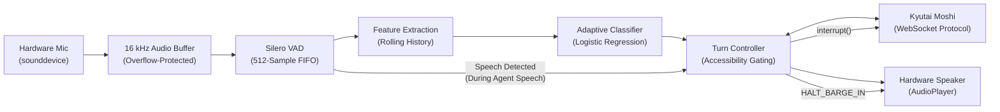

# An Adaptive, Accessibility-Aware Agent Harness for Full-Duplex Voice Models

A research-oriented software harness surrounding full-duplex conversational voice models (e.g., Kyutai Moshi) featuring intelligent, accessibility-aware turn-taking, adaptive pause classification, and instant barge-in interruption.

---

## 1. Project Overview

Standard voice assistants typically enforce rigid silence cutoffs (e.g., 500 ms – 800 ms) to decide when a user has finished speaking. For individuals with speech variations, dysarthria, apraxia, or natural thinking hesitations, this causes frequent, frustrating premature interruptions.

This project implements an **Agent Harness** — an intelligent software middleware surrounding a full-duplex speech model — that dynamically distinguishes between:
- A user who has finished speaking (`END`).
- A user who is temporarily hesitating or formulating words (`CONTINUE`).
- A user who interrupts the assistant (**Barge-in**).

### Core Research Capabilities
1. **Dynamic Pause Modeling**: Evaluates current pause duration against the speaker's rolling acoustic history ($\mu, \sigma$) and sensitivity preset weights.
2. **Physical Hardware Pipeline**: Live microphone capture (`sounddevice.InputStream`), 16 kHz polyphase resampling, 512-frame Silero VAD, and low-latency speaker playback (`sounddevice.OutputStream`).
3. **True Barge-In Interruption**: Instantly silences audio hardware output and halts Moshi inference upon user speech during assistant playback.
4. **Genuine Kyutai Moshi Integration**: True WebSocket streaming client communicating via binary PCM audio chunks and control frames with honest connection state tracking (`DISCONNECTED`, `CONNECTING`, `CONNECTED`, `SESSION_ACTIVE`, `CONNECTION_FAILED`, `SESSION_ERROR`).
5. **TORGO Speech Corpus Integration**: 8,218 clean head-microphone files across 15 speakers with mathematical zero speaker leakage.
6. **Empirical Benchmarking & Annotation**: Automated metrics (FIR, FWR, Precision, Recall, F1, Latency P50/P90, Confusion Matrix) and multi-window acoustic context labeling studio.

> **Important Research Disclaimer:** This software is an experimental research prototype and engineering framework. It is not a clinically validated medical device.

---

## 2. System Architecture



---

## 3. Repository Structure

```text
Harness/
├── app.py                      # Modern SaaS Streamlit Research Dashboard
├── cli_simulate.py             # Dual-mode terminal streaming (file & live microphone)
├── requirements.txt            # Python dependencies
├── README.md                   # Project documentation
│
├── .streamlit/
│   └── config.toml             # Native white theme with purple accents
│
├── config/
│   ├── settings.py             # Audio sample rates, VAD, and model paths
│   └── sensitivity.py          # Patient, Normal, and Quick mode definitions
│
├── audio/
│   ├── preprocessing.py        # 16 kHz resampling, mono conversion, framing
│   ├── audio_stream.py         # Hardware mic capture & speaker playback (sounddevice)
│   └── visualization.py        # Light-mode waveforms & spectrograms with VAD overlays
│
├── vad/
│   ├── silero_detector.py      # Silero VAD wrapper (512-sample frame engine)
│   └── extract_pauses.py       # Candidate pause extractor for TORGO recordings
│
├── dataset/
│   ├── dataset_manifest.py     # Speaker-disjoint manifest builder & verifier
│   ├── annotation_pilot.py     # Context-sliced audio extractor & annotation manager
│   └── inventory.py            # Complete audio corpus audit
│
├── classifier/
│   ├── feature_extraction.py   # Rolling pause tracker & feature vector builder
│   ├── pause_classifier.py     # Scikit-learn Logistic Regression + StandardScaler
│   └── train.py                # Supervised training & evaluation pipeline
│
├── controller/
│   └── turn_controller.py      # Turn-taking state machine, response gate, barge-in
│
├── model/
│   └── moshi_adapter.py        # Genuine Kyutai Moshi WebSocket client
│
├── evaluation/
│   ├── baseline.py             # Static fixed-threshold baselines (500ms, 800ms, etc.)
│   ├── metrics.py              # FIR, FWR, Precision, Recall, F1, Latency, Confusion Matrix
│   └── evaluate.py             # Comparative benchmarking suite & cohort analysis
│
├── outputs/
│   ├── benchmark_comparison.csv# Empirical comparative metrics
│   ├── confusion_matrices.json # Full TP, FP, TN, FN breakdown
│   ├── final_integration_report.md # Verification report
│   └── models/                 # Serialized model weights & scalers
│
└── tests/
    ├── test_harness.py         # Pipeline unit tests
    ├── test_annotation.py      # Annotation data integrity tests
    └── test_live_and_moshi.py  # Audio buffer, mic enumeration, & Moshi tests
```

---

## 4. Quick Start & Operating Guide

### 4.1 Launch the Research Dashboard
```bash
streamlit run app.py
```
Open `http://localhost:8501` to access:
- **Tab 1: Live Voice Interaction Studio** (Live microphone streaming, VAD monitoring, and genuine Moshi connection).
- **Tab 2: Dataset & Corpus Explorer** (TORGO metadata, partition breakdown, and audio player).
- **Tab 3: Empirical Benchmarks & Evaluation** (FIR, FWR, latency, and confusion matrix breakdown).
- **Tab 4: Ground-Truth Annotation Studio** (Multi-window context audio review and labeling).

### 4.2 Terminal Streaming CLI
```bash
# Offline TORGO file simulation
python cli_simulate.py --preset patient

# Live microphone streaming
python cli_simulate.py --mic --preset patient
```

### 4.3 Running Genuine Kyutai Moshi Server (GPU Host)
To run the genuine Kyutai Moshi server instance on a GPU-enabled machine:
```bash
pip install moshi
python -m moshi.server --port 8998
```
Then enter `ws://<gpu-ip>:8998/api/chat` into the dashboard and click **"Connect to Moshi"**.

---

## 5. Test Suite Verification

Run the full test suite (25 tests):
```bash
python -m unittest discover -s tests -v
```
```text
Ran 25 tests in 2.868s
OK (25/25 passing, 0 failures, 0 errors)
```
